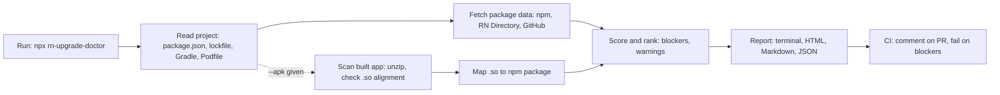

# RN Upgrade Doctor — design

## 1. Problem
React Native upgrades are slow and risky because nobody knows upfront which libraries will break. Teams find out late,
from build errors, crashes or a Play Store rejection. Since 1 Nov 2025 Google Play blocks updates for apps targeting
Android 15+ that don't support 16 KB memory pages, and the error doesn't say which npm package caused it.

**Who it's for:** React Native developers, tech leads planning an upgrade, agencies maintaining many apps.

## 2. Solution
One command run inside any React Native project: `npx rn-upgrade-doctor [--apk app.aab]`. It produces one prioritised
report (blockers first, then warnings) and can run in CI on every pull request.

## 3. Competition and our difference
| Existing | What it does | Gap we fill |
| --- | --- | --- |
| React Native Package Checker (web) | Drop package.json, see New Architecture support | No CLI/CI, no built-app scan, no 16 KB check |
| expo doctor | Expo project health | Expo-focused; no 16 KB scan of the built app |
| Official upgrade helper | File diff between RN versions | Doesn't look at your dependencies |
| Google's 16 KB check script | .so alignment in an APK | Doesn't map failures to npm packages or fixes |

Difference: one command, CI-ready, scans the built APK/AAB and names the npm package behind each failing native
library, with advice from real major upgrades.

## 4. How it works (flow)

## 5. Checks (MVP)
| Area | Check | Severity |
| --- | --- | --- |
| RN version | Installed vs latest; minor versions behind; upgrade-helper link | warning (blocker if very old) |
| Dependencies | Installed vs latest; last publish date; archived repo | warning |
| New Architecture | Library support from React Native Directory data | blocker if unsupported and newArch enabled/required |
| Android | targetSdk / compileSdk / minSdk vs Play requirements; newArchEnabled; hermesEnabled | blocker/warning |
| 16 KB | Each arm64-v8a / x86_64 `.so`: ELF PT_LOAD p_align >= 16384; uncompressed .so zip alignment | blocker |
| iOS | Podfile platform :ios version; Podfile.lock pod versions | warning |
| Patches | `patches/*.patch` (patch-package) on packages being upgraded | warning |

## 6. Tech stack
| Part | Choice |
| --- | --- |
| Runtime | Node.js 20+, TypeScript (strict, ESM) |
| CLI | commander |
| Terminal | picocolors, cli-table3 |
| Lockfiles | own parsers for package-lock.json, yarn.lock (v1 + berry), pnpm-lock.yaml (yaml) |
| Data | npm registry API; React Native Directory data (verify current API); GitHub REST API (optional token) |
| 16 KB | yauzl to read the zip; small ELF64 program-header parser |
| Mapping | search node_modules for each .so name + CMake target names; known-library table in src/rules |
| Reports | HTML (single file, inline CSS), Markdown, JSON |
| CI | GitHub Action (composite) |
| Tests | Vitest, fixture projects, sample APKs |

## 7. Report outputs
- **Terminal** (default): header (RN version gap, upgrade-helper link), blocker / warning / info counts, ranked findings
  with fix and data source, dependency table, Android and iOS config, 16 KB summary, data sources.
- **HTML:** the same in a single self-contained page (inline CSS, light and dark).
- **Markdown:** the same, for PR comments and the GitHub job summary.
- **JSON:** `{ meta, summary, findings[], dependencies[], android, ios, patches[], apk }` for CI and other tools.

## 8. Features
MVP: version gap, dependency table, Android/iOS checks, 16 KB scan + mapping, patch detection, 3 report formats,
GitHub Action.
Done since: monorepos (npm/yarn/pnpm workspaces), missing-data findings, offline example scenarios.
Later: Expo support, `--to <version>` target, "fix" mode with suggested version bumps, GitHub archived-repo check,
VS Code extension, history across runs.

## 9. What's required
Accounts: GitHub, npm (free). Tools: Node 20+, Android Studio + SDK (to build test APKs), Xcode (optional).
Test material: text-only scenarios in `examples/` (committed); 1–2 sample RN apps built from the public template, with
release APKs, under `fixtures/` (git-ignored).
Device: optional Android 15 emulator with a 16 KB system image.

## 10. Challenges and mitigations
| Challenge | Mitigation |
| --- | --- |
| .so names don't match package names | Search node_modules build files and CMake targets; known-library table; show "unknown" honestly |
| RN Directory data missing/stale | Fall back to npm publish dates + GitHub archived flag; label sources |
| Many project shapes | Bare React Native and monorepos; Expo later; say so in README |
| API rate limits | Local cache; optional GITHUB_TOKEN |
| Advice goes stale | Rules in one versioned file; update per RN release |
| Low adoption | Real story + demo; answer issues fast |
